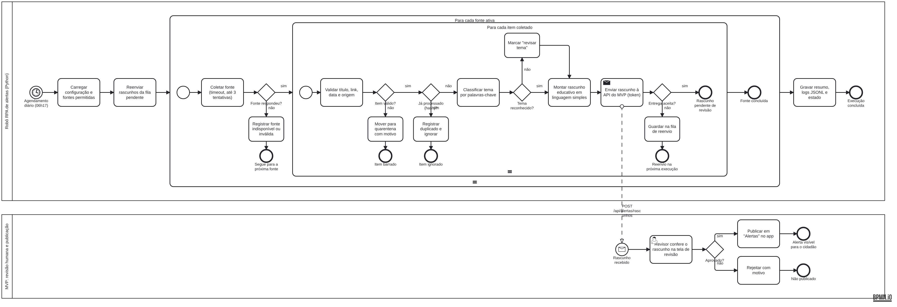

# Conecta 60+ — Robô de Alertas de Golpes (RPA)

> Global Solution 2026.2 · CitizenTech · Robotic Process Automation

O **Conecta 60+** é uma plataforma de inclusão e segurança digital para pessoas com 60 anos ou mais. Este repositório reúne o **robô de RPA** que mantém atualizada a área de *Alertas de golpes* e o **MVP web** que recebe, revisa e publica esses alertas.

O robô coleta avisos sobre golpes em fontes confiáveis, valida e filtra o conteúdo, elimina repetições, classifica o tipo de golpe e prepara um alerta em linguagem simples. Nenhum alerta é publicado automaticamente: todo rascunho passa por revisão humana antes de chegar ao cidadão.

| | |
| --- | --- |
| 🎥 **Vídeo demonstrativo** | https://youtu.be/1oUd6ioEMkQ |
| 📂 **Repositório** | https://github.com/LivNS/Conecta-60-RPA |
| 📄 **Relatório técnico** | [`rpa/docs/relatorio/conecta60.pdf`](rpa/docs/relatorio/conecta60.pdf) |
| 🗺️ **Fluxo BPMN** | [`rpa/docs/fluxo-rpa-alertas.bpmn`](rpa/docs/fluxo-rpa-alertas.bpmn) |

## Integrantes

| Nome completo | RM |
| --- | --- |
| Debora da Silva Amaral | 550412 |
| Eduardo Pielich | 99767 |
| Livia Namba Seraphim | 97819 |

---

## O problema

Golpes digitais mudam toda semana. Manter uma área de alertas atualizada exige acompanhar fontes confiáveis, separar o que realmente trata de golpe, verificar se o aviso já foi publicado, reescrevê-lo em linguagem acessível e registrar o que foi feito. Feito à mão, esse processo é lento e sujeito a esquecimentos, duplicidades e erros.

## A solução

| Etapa | Quem faz |
| --- | --- |
| Coletar avisos em fontes confiáveis | Robô |
| Validar origem, data e formato | Robô |
| Descartar notícias que não tratam de golpe | Robô |
| Ignorar itens já processados | Robô |
| Classificar o tipo de golpe | Robô |
| Escrever o alerta em linguagem simples, com dicas de proteção | Robô |
| Entregar o rascunho ao MVP | Robô |
| Aprovar ou rejeitar o alerta | **Revisor humano** |
| Exibir o alerta ao cidadão | MVP |

---

## Arquitetura

```
┌───────────────────────────┐        POST /api/alertas/rascunhos        ┌──────────────────────────┐
│  Robô RPA (Python)        │  ───────────────────────────────────────▶ │  MVP (FastAPI + SQLite)  │
│  agendado no GitHub       │          Authorization: Bearer            │                          │
│  Actions (diário, 6h17)   │                                           │  /revisao  → revisor     │
│                           │                                           │  /alertas  → cidadão     │
│  Fontes:                  │                                           └──────────────────────────┘
│  • Agência Brasil (RSS)   │
│  • Boletins JSON/CSV      │──▶ logs/  (auditoria JSONL)
└───────────────────────────┘──▶ estado/ (memória de itens e fila de reenvio)
```

## Fluxo do processo (BPMN)



O arquivo editável [`fluxo-rpa-alertas.bpmn`](rpa/docs/fluxo-rpa-alertas.bpmn) abre no [bpmn.io](https://demo.bpmn.io) e no Camunda Modeler.

---

## Regras de negócio

Para cada item coletado, o robô aplica cinco decisões em sequência:

| Decisão | Regra | Se não passar |
| --- | --- | --- |
| 1. O item é válido? | Título com 10+ caracteres, link http(s), domínio presente na lista da fonte, data legível, não futura e com até 180 dias | Quarentena, com o motivo registrado |
| 2. Fala de golpe? | Em fontes de notícias gerais, o texto precisa conter termos como *golpe*, *fraude*, *estelionato*, *phishing* ou *clonagem* | Descartado como fora do tema |
| 3. Já foi processado? | Hash SHA-256 do título normalizado + link, comparado com a memória das execuções anteriores | Ignorado como duplicado |
| 4. O tema foi reconhecido? | Palavras-chave em seis temas: falso contato do banco, falso parente pedindo Pix, código de verificação, falso suporte técnico, falsa promoção, golpes com aposentadoria ou benefício | Rascunho marcado "revisar tema" |
| 5. A entrega foi aceita? | API respondeu 201 (criado) ou 409 (já existente) | Fila de reenvio automático |

## Tratamento de exceções

| Situação | Tratamento |
| --- | --- |
| Fonte fora do ar, tempo esgotado ou HTTP 5xx | Até 3 tentativas com espera crescente; depois registra o erro e segue para a próxima fonte |
| Feed corrompido | Fonte registrada como inválida; o processamento continua |
| Arquivo JSON/CSV corrompido | Movido para `entrada/quarentena/` |
| Item duplicado ou inconsistente | Ignorado ou enviado à quarentena com o motivo |
| API do MVP fora do ar ou token recusado | Rascunho guardado na fila e reenviado na execução seguinte |
| Erro inesperado em um item | Registrado; os demais itens continuam |
| Configuração ausente ou sem token | Execução interrompida com mensagem clara |

O robô conclui o processamento de todas as fontes antes de encerrar. Quando algo exige atenção, termina com código de saída `1`, o que sinaliza a execução agendada para acompanhamento.

---

## Como executar (Windows · cmd)

**Pré-requisito:** Python 3.11 ou superior.

### 1. Instalar as dependências

```cmd
cd app
py -m pip install -r requirements.txt
cd ..\rpa
py -m pip install -r requirements.txt
```

### 2. Subir o MVP (terminal 1)

```cmd
cd app
set "RPA_API_TOKEN=demo"
set "ADMIN_USUARIO=revisor"
set "ADMIN_SENHA=demo"
set "PYTHONPATH=src"
py -m uvicorn app_alertas.main:app --port 8001
```

- Revisão: http://127.0.0.1:8001/revisao (usuário `revisor`, senha `demo`)
- Alertas públicos: http://127.0.0.1:8001/alertas
- Documentação da API: http://127.0.0.1:8001/docs

### 3. Executar o robô (terminal 2)

```cmd
cd rpa
mkdir entrada
copy exemplos\entrada\* entrada\
set "PYTHONPATH=src"
set "RPA_MODO_ENTREGA=api"
set "RPA_API_URL=http://127.0.0.1:8001"
set "RPA_API_TOKEN=demo"
py -m rpa_alertas
```

Os rascunhos aparecem em `/revisao`. Após a aprovação, passam a ser exibidos em `/alertas`.

### 4. Rodar os testes

```cmd
cd rpa
py -m pytest -q
cd ..\app
py -m pytest -q
```

### 5. Reproduzir os cenários de falha

```cmd
:: com o MVP desligado (Ctrl+C no terminal 1)
copy exemplos\entrada_extra\* entrada\
py -m rpa_alertas
:: os rascunhos vão para a fila; suba o MVP de novo e rode o robô outra vez
py -m rpa_alertas
```

<details>
<summary>Linux e macOS</summary>

```bash
# MVP
cd app && pip install -r requirements.txt
RPA_API_TOKEN=demo ADMIN_USUARIO=revisor ADMIN_SENHA=demo PYTHONPATH=src uvicorn app_alertas.main:app --port 8001

# Robô (outro terminal)
cd rpa && pip install -r requirements.txt
mkdir -p entrada && cp exemplos/entrada/* entrada/
PYTHONPATH=src RPA_MODO_ENTREGA=api RPA_API_URL=http://127.0.0.1:8001 RPA_API_TOKEN=demo python -m rpa_alertas
```
</details>

---

## Integração com o MVP

| Resposta da API | Significado | Ação do robô |
| --- | --- | --- |
| `201` | Rascunho criado | Registra a entrega |
| `409` | Rascunho já existente | Contabiliza como já existente |
| `401` | Token inválido | Envia para a fila de reenvio |
| `422` | Formato inválido | Envia para a fila de reenvio |

O token do robô permite apenas criar rascunhos. Aprovar e publicar exige o login do revisor.

## Logs e auditoria

Cada execução gera, em `rpa/logs/`:

- `execucao_<id>.jsonl` — um evento por linha: data e hora, nível, etapa, fonte, item, resultado e mensagem;
- `resumo_<id>.json` — contagens da execução.

Antes da gravação, um filtro mascara CPF, número de cartão, e-mail, telefone e tokens. Amostras estão em [`rpa/logs/amostras`](rpa/logs/amostras) e as saídas dos cenários de teste em [`rpa/evidencias`](rpa/evidencias).

## Testes

| Componente | Testes | Cobertura |
| --- | --- | --- |
| Robô RPA | 22 | Sucesso, regras de decisão, falhas e mascaramento de dados |
| API do MVP | 11 | Autenticação, validação, duplicidade, aprovação, rejeição e revisão de tema |

## Agendamento

O workflow [`.github/workflows/rpa-alertas.yml`](.github/workflows/rpa-alertas.yml) executa os testes e o robô todos os dias às 6h17 (horário de Brasília), e também pode ser disparado manualmente em **Actions → Run workflow**. A memória de itens e a fila de reenvio são preservadas entre execuções, e os logs de cada execução ficam disponíveis como artefato. Token e URL da API são configurados nos segredos do repositório (`RPA_API_TOKEN` e `RPA_API_URL`).

## Segurança e LGPD

- O robô lê apenas conteúdo público de fontes institucionais e não coleta dados de pessoas.
- Logs sem dados pessoais, com mascaramento coberto por testes.
- Credenciais em variáveis de ambiente e segredos do GitHub, nunca no código.
- Revisão humana obrigatória antes de qualquer publicação.
- O robô lê somente o feed da fonte cadastrada e nunca acessa os links das notícias.
- Cada alerta cita a fonte original e usa apenas um resumo curto do conteúdo.
- Os boletins de `rpa/exemplos` são fictícios e usam domínios de exemplo (`exemplo.org`, `exemplo.gov.br`).

---

## Tecnologias

| Tecnologia | Uso |
| --- | --- |
| Python | Robô RPA e API do MVP |
| requests · xml.etree | Coleta HTTP e leitura de RSS/Atom |
| FastAPI · Jinja2 · SQLite | API, tela de revisão e página pública |
| pytest | Testes automatizados |
| GitHub Actions | Agendamento e execução sob demanda |
| BPMN 2.0 | Modelagem do processo |
| Docker | Empacotamento do MVP |

## Estrutura do repositório

```
.
├── app/                         MVP web (FastAPI)
│   ├── src/app_alertas/         API, tela de revisão e página pública
│   ├── tests/                   11 testes
│   └── Dockerfile
├── rpa/                         Robô de alertas
│   ├── config/fontes.json       fontes permitidas e modo de entrega
│   ├── src/rpa_alertas/         coleta, regras, rascunho, envio, logs
│   ├── tests/                   22 testes
│   ├── exemplos/                boletins fictícios de demonstração
│   ├── docs/                    BPMN, relatório técnico e roteiro do vídeo
│   ├── assets/                  capturas de tela
│   ├── logs/amostras/           amostras de log
│   └── evidencias/              saídas dos cenários de teste
├── scripts/                     integração de ponta a ponta robô + MVP
└── .github/workflows/           agendamento do robô
```
